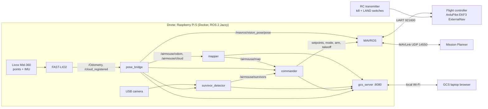

# AirMouse implementation plan

The goal is an autonomous, GPS-denied indoor drone for NIDAR Track 1 (AirMouse). It must enter a maze of up to 15 × 15 m through a single entry, explore it, find up to 6 survivors, and tag each one's grid cell on a live 2D map. It then leaves through the same point. The flight-time limit is 30 minutes and no manual intervention is allowed.

---

## 1. What wins this mission

| Scoring driver (from the brief) | Design response |
|---|---|
| Full autonomy; the operator may only start and abort | Commander state machine. The only inputs are START, RECALL and ABORT. Every failsafe ends in LAND, never in an RTL that would fly through walls. |
| No GPS | FAST-LIO2 LiDAR-inertial odometry feeds the ArduPilot EKF3 as external navigation |
| Live 2D map, drone position, survivor tags and camera feed on the GCS *during flight* | The web GCS is served from the drone and updated at 2–4 Hz. Nothing is post-processed after landing. |
| Grid coordinate of each survivor | Configurable rescue grid (`arena.*`), with labels such as `C7` shown on the map and in the survivor table, and also sent to Mission Planner as STATUSTEXT |
| Shortest time | Frontier exploration at 0.7 m/s, with the detector running continuously while moving and a short 360° yaw sweep at each frontier goal |
| Safe flight in 1 m corridors | Small airframe with guards, 0.30 m inflation in the planner, a geofence, and a SLAM-health watchdog |
| No external network | Local Wi-Fi link only. The GCS page, models and maps all live on the drone. |

---

## 2. Key decisions

| Topic | Decision | Why |
|---|---|---|
| Firmware | **ArduPilot ArduCopter 4.6** | The brief says "Mission Planner", and ArduPilot's EKF3 ExternalNav is mature and well documented |
| LiDAR | **Livox Mid-360**, mounted **upside-down** under the frame | 360° × 59° FOV, 0.1 m minimum range, built-in IMU, 265 g. Mounted inverted, its −52° view covers the floor, so a dummy lying on the floor is seen too. (Unitree L2 is a cheaper alternative with FAST-LIO support.) |
| SLAM | **FAST-LIO2** (`hku-mars/FAST_LIO`, ROS2 branch) | Tightly coupled LiDAR+IMU iterated EKF. It is robust to aggressive motion, runs comfortably on ARM, and is the de facto choice for Mid-360 drones. A 15 m arena needs no loop closure (drift stays under ~10 cm). |
| SLAM fallback | Point-LIO (same config style) or KISS-ICP | Swap these in only if FAST-LIO degenerates in long, featureless corridors |
| Companion | Raspberry Pi 5 16 GB, **Raspberry Pi OS + Docker (ROS 2 Jazzy, Ubuntu 24.04 image)** | Raspberry Pi OS has the best Pi 5 hardware support, and Docker gives the identical software environment on the drone and on every laptop |
| Simulation | **Gazebo Harmonic + ArduPilot SITL** (JSON / ardupilot_gazebo plugin) | Gazebo Harmonic is the official pairing with Jazzy. SITL runs the real ArduPilot code, so EKF and failsafe behaviour transfer to the drone. |
| Detection | YOLO11n, person class, 416 px, NCNN on the Pi (~8–12 FPS on CPU); the node runs it at 4 Hz | Good enough on people and dummies. A Hailo-8L AI HAT+ is an optional upgrade. |
| Survivor localisation | LiDAR points projected into the bounding box, falling back to a floor-plane ray | Gives a metric position to within roughly 0.2 m, which is far below the 1 m grid cell |
| GCS | Web dashboard on the drone (port 8080), plus Mission Planner for MAVLink status, arming state and an emergency mode change | Mission Planner cannot draw an occupancy map or survivor tags natively. The web GCS can, works offline, and runs on any laptop. |

---

## 3. System architecture

In simulation, Gazebo replaces the LiDAR, camera, IMU and motors, and ArduPilot SITL replaces the flight controller. Every other box runs unchanged.

### Nodes and topics

| Node | Inputs | Outputs |
|---|---|---|
| `fast_lio` | `/livox/lidar` + `/livox/imu` (sim: `/lidar/points` + `/imu/data`) | `/Odometry`, `/cloud_registered` |
| `pose_bridge` | FAST-LIO output | `/airmouse/odom`, `/airmouse/cloud`, `/mavros/vision_pose/pose`, `/airmouse/slam_ok`, TF `map→base_link` |
| `mapper` | `/airmouse/cloud`, `/airmouse/odom` | `/airmouse/map` (OccupancyGrid, 5 cm) |
| `commander` | map, odom, slam_ok, MAVROS state/pose/battery, `/airmouse/cmd`, survivors | `/mavros/setpoint_position/local`, MAVROS services, `/airmouse/status`, `/airmouse/path`, STATUSTEXT |
| `survivor_detector` | camera image/info, `/airmouse/cloud`, odom | `/airmouse/survivors`, `/airmouse/detections`, markers |
| `gcs_server` | everything above | HTTP: `/`, `/api/state`, `/map.png`, `/video.mjpg`, `POST /api/cmd` |

### Frames and the rescue grid

- **map**: `base_link` at take-off. +x points into the maze from the entry, +y to the left, z up. The ArduPilot local frame equals this frame because the vision pose is expressed in it. The commander also corrects any small FCU-frame offset.
- **pose_bridge** handles the inverted LiDAR. With `M = T_base_lidar` it computes `T_map_base = M · T_fastlio · M⁻¹` and `p_map = M · p_fastlio`.
- **Rescue grid**: the origin is the left-hand corner of the entry wall, seen facing into the maze. Letters run left to right and numbers run from the entry inward, with 1 m cells. On the day, set `arena.origin_x/origin_y` from the launch box's position, and change the cell size and labels to match the organisers' grid.

---

## 4. Hardware integration (real drone)

| Item | Notes |
|---|---|
| Airframe | It must fit 1 m corridors and doors. Aim for **≤ 45 cm wide including full prop guards**. A 5"–7" ducted or guarded frame at 1.5–2.5 kg AUW is well under the 10 kg limit. |
| Flight controller | Any ArduPilot board (e.g. Pixhawk 6C, Matek H743). TELEM2 connects to Pi 5 GPIO14/15 UART (`/dev/ttyAMA0`, 921600). |
| Mid-360 | Mount it upside-down under the centre with vibration isolation, and keep props and guards out of its FOV (above +7°). Power it from 9–27 V. Connect Ethernet to the Pi. |
| Camera | Wide-angle USB UVC (≥ 90° HFOV), facing forward and tilted 15° down. USB is simpler than CSI inside Docker. |
| Pi 5 power | A dedicated 5 V / 5 A BEC, plus an active cooler. Throttling under load will hurt SLAM. |
| Link | 5 GHz Wi-Fi with the Pi as access point, or a small travel router at the GCS. This is a local link, which the rules allow. Mission Planner connects over the same link via MAVROS `gcs_url`. |
| RC | Its only roles are an ELRS/FrSky receiver with a **motor emergency stop** switch (`RC7_OPTION 31`) and a LAND switch. The pilot does not fly. |
| Optional backup | Downward rangefinder plus optical flow (e.g. MTF-01), configured as EKF source set 2 in case LiDAR odometry fails |

---

## 5. Phased plan

Each phase has an exit criterion. Do not move on until it passes. Durations assume 2–3 people working part-time.

### Phase 0: Environment (week 1)
- [ ] Put this project in a git repo (GitHub/GitLab, private), not OneDrive.
- [ ] Build the `sim` image on one laptop. Run `am-build`, then `am-sim`.
- [ ] Pin `deps.repos` to exact commits once FAST-LIO and the Livox driver compile.
- [ ] Build the image on a second laptop from the repo alone, to prove portability.
- **Exit:** Gazebo shows the maze and drone. `ros2 topic hz /lidar/points /imu/data /camera/image_raw` shows 10 / 200 / 15 Hz.

### Phase 1: SLAM in simulation (week 1–2)
- [ ] FAST-LIO runs on simulated data (`/Odometry` at 10 Hz).
- [ ] Carry the drone by hand around the maze using `gz` pose commands, or fly it in GUIDED mode via Mission Planner. Compare against Gazebo ground truth (`/world/<name>/pose/info`).
- [ ] Add a small ground-truth comparison script that logs the error.
- **Exit:** drift < 0.15 m over a full lap of the maze. The pose stays sane in the long 14 m corridors.

### Phase 2: External-nav flight in SITL (week 2)
- [ ] ArduPilot EKF3 accepts the vision pose (Mission Planner shows "EKF3 IMU0 is using external nav data").
- [ ] Arm, take off and hold position in GUIDED. Fly position setpoints by hand from a script.
- [ ] Failsafes: kill FAST-LIO in flight and confirm the drone LANDs. Stop MAVROS and confirm it LANDs (GCS failsafe).
- **Exit:** a 2 min hover drifts less than 0.1 m, and every failsafe lands.

### Phase 3: Mapping and GCS (week 3)
- [ ] The 2D map grows live in the browser, with walls, doors and rooms clearly readable.
- [ ] Rescue-grid labels line up with the maze, checked against `maze_gen` ground truth.
- [ ] MJPEG video and status bar work. START, RECALL and ABORT behave as specified.
- **Exit:** a screenshot of the GCS map that a stranger can use to point to every room.

### Phase 4: Autonomous exploration and return (weeks 3–5)
- [ ] Frontier exploration covers 100% of `maze_01` and returns to the exit.
- [ ] Write 5+ more layouts: dead ends, loops, a long corridor, rooms off rooms, narrow 1 m doors.
- [ ] Tune `inflation_radius`, `goal_switch_margin`, `spin_at_goals`, `WPNAV_SPEED`.
- [ ] Add a time-budget test: force `max_explore_time_s: 120` and confirm it returns.
- **Exit:** 10/10 runs over 5 layouts with full coverage, no collisions, and a landing at the exit. Median time under 8 minutes.

### Phase 5: Survivor detection and localisation (weeks 4–6)
- [ ] Detection on Gazebo people (standing, sitting dummy). Add more Fuel models and poses.
- [ ] Localisation error under 0.3 m against ground truth. No duplicate IDs. No tags outside the arena (spectators visible through the entry are rejected).
- [ ] Collect real images (team members, a mannequin or dummy, in low light) and check YOLO recall. Fine-tune YOLO11n on them if recall is under 95%.
- **Exit:** in sim, 6/6 survivors tagged in the correct cell on 10/10 runs.

### Phase 6: Hardware bring-up, bench and handheld (weeks 5–7, overlapping)
- [ ] Mount the sensors and measure the mount values (`MEASURE` entries in `airmouse.yaml`).
- [ ] Bring up the Mid-360 and camera on the Pi. Run FAST-LIO **handheld** (no props) through a corridor, and check that the map and `pose_bridge` axes are correct (forward = +x, left = +y, up = +z).
- [ ] Check CPU, temperature and latency with everything running (`htop`, `vcgencmd measure_temp`). Target total CPU under 70% and FAST-LIO latency under 30 ms.
- [ ] Load `real.parm`, confirm the FC sees external nav, and test the RC kill switch with props off.
- **Exit:** a handheld walk produces a clean 2D map and correct survivor tags on the GCS.

### Phase 7: Real flights (weeks 7–9)
- [ ] Tethered or netted hover in GUIDED with the vision pose: 2 min, under 0.15 m drift.
- [ ] Build a mock arena section (plywood or cardboard, 1 m corridor, a 2 × 2 m room, 2.44 m walls) with a net ceiling.
- [ ] Autonomous runs at `WPNAV_SPEED 40`, then raise the speed step by step.
- [ ] Repeat every failsafe for real: link loss, low battery, abort button, kill switch.
- **Exit:** 5 consecutive autonomous missions in the mock arena with no touches.

### Phase 8: Competition readiness (weeks 9–10)
- [ ] A setup drill under 5 minutes with 2 people (checklist below), rehearsed 10 times.
- [ ] Spares: props, guards, 3+ charged packs, spare Pi SD card with the image, spare camera.
- [ ] Freeze the code. Tag the release in git and save the Docker image (`docker save`).

### Day-of setup checklist (≤ 5 min)
1. Place the drone in the 2 × 2 ft launch box, square to the entry and facing in. Measure the distance to the entry wall and the offset to its left corner, and set `arena.origin_x/y`.
2. Connect the battery and wait for the Pi to boot (the container starts on boot).
3. Power the GCS laptop and join the drone Wi-Fi. Open `http://<pi>:8080` and Mission Planner.
4. Confirm SLAM OK, the FCU link, battery %, the map showing the entry area, and live video.
5. Operator presses **START**, then keeps hands off except for ABORT or the kill switch.

---

## 6. Test strategy

| Level | What | Where |
|---|---|---|
| Unit | `arena.py` labels, `planning.py` (wavefront, frontiers, simplify), `maze_gen` geometry | pytest in the container (to be added: `ros2_ws/src/airmouse/test/`) |
| Integration | Full mission on N layouts, scoring coverage %, survivors found, cell accuracy and time | Headless SITL batch script (to be added: `scripts/batch_sim.sh`) |
| Robustness | LiDAR noise ×3, IMU noise, 30% camera frame drops, a person standing in a doorway, a blocked corridor | SITL |
| Hardware-in-loop | Handheld FAST-LIO, tethered hover, mock arena | Real |

Record a rosbag of every real flight: `ros2 bag record /livox/lidar /livox/imu /camera/image_raw /airmouse/status /mavros/state`. Replaying a bag through FAST-LIO and the detector is the fastest way to debug.

---

## 7. Rule-compliance checklist

| Rule | How it is met |
|---|---|
| Custom airframe, AUW ≤ 10 kg, prop guards | Own build. Weigh it with everything installed. |
| GPS/GNSS not used | `GPS1_TYPE 0`, and the EKF uses ExternalNav only |
| Only start and abort by the operator | GCS buttons START, RECALL (emergency recall, listed under failsafes) and ABORT. The RC carries only kill and LAND switches. |
| No FPV goggles or other viewing devices | All video is in the GCS browser and Mission Planner on one laptop |
| Map, tags and data produced during flight | Live topics, with no post-processing step |
| No external network | Local Wi-Fi AP. The YOLO weights are baked into the image, and the GCS page has no CDN dependencies. |
| Failsafes: low battery, link loss, geofence, abort, recall | BATT_FS → LAND, FS_GCS → LAND, FENCE → LAND, ABORT → LAND, RECALL → planned return, SLAM loss → LAND |
| Launch from 2 × 2 ft box | Airframe ≤ 45 cm fits |

---

## 8. Risks and mitigations

| Risk | Impact | Mitigation |
|---|---|---|
| LiDAR degeneracy in long, uniform corridors (FAST-LIO slides along the corridor axis) | Position drift, crash | The 360° FOV sees corridor ends within 15 m, and the inverted mount adds floor features. Keep `filter_size` small. Optical-flow backup as EKF source 2. The SLAM-jump detector triggers LAND. |
| Wall-coloured fabric or net walls with weak LiDAR returns | Holes in the map | Validate on the real wall material early (Phase 6). Lower `occupied_threshold`. |
| Prop wash disturbing dummies or the net | Map noise | The height band excludes the ceiling, and log-odds filtering handles it |
| Pi 5 thermal throttling | SLAM latency | Active cooler. Run the detector at 4 Hz with NCNN. Watch `vcgencmd get_throttled`. |
| Organisers' grid convention differs | Wrong cell labels | All grid params are configurable. Ask the organisers (§9). |
| Wi-Fi drops inside the arena | GCS stops updating | Autonomy is fully onboard and the mission continues. The map is re-sent continuously, so it recovers when the link returns. |
| Gazebo person meshes vs real people/dummies | Sim overestimates detection | Fine-tune on real images. Test dummies lying down. |
| Doors only 1 m wide | Collisions | Inflation 0.30 m, slow speed through doors, a ≤ 45 cm airframe |

---

## 9. Questions to ask the organisers

1. How are the grid coordinates labelled (origin corner, cell size, letter/number orientation)? Will they give a reference grid drawing?
2. What are the wall and ceiling-net materials? Are the walls opaque to LiDAR?
3. Survivors: are they lying, sitting or standing? Are they thermal-visible (heated dummies), or is it visual only?
4. Is the entry/exit at ground level, and is the launch box inside or outside the maze?
5. How is "exit the maze" judged: by landing at the launch box, or by crossing the entry line?
6. Is a local Wi-Fi AP on the drone acceptable as the "team's local communication link"?

---

## 10. Status of this repository (initial scaffold)

This repository was **written, not yet run**. Nothing has been built or tested yet. Expect to fix small issues during Phase 0–1, especially:
- FAST-LIO and livox_ros_driver2 compiling on ROS 2 Jazzy / GCC 13 (`scripts/build_deps.sh`). If it fails, try a Jazzy-ready fork of FAST-LIO.
- `airmouse_sim/drone_model.py` injects sensors into `iris_with_ardupilot`. Check that the sensor links attach to the correct parent link in your ardupilot_gazebo version.
- Fuel model names for survivors in `maze_gen.py`. The first download needs internet, after which they are cached.
- ArduPilot parameter names that changed between versions (`GPS1_TYPE` vs `GPS_TYPE`).
